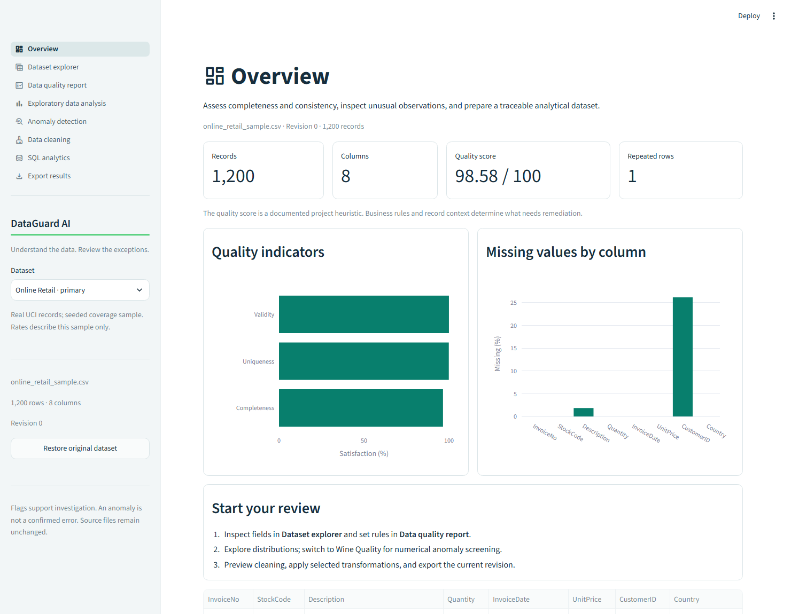
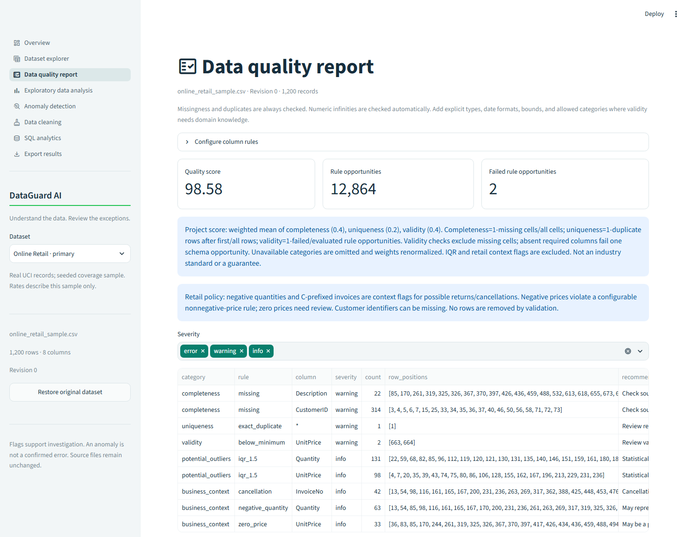
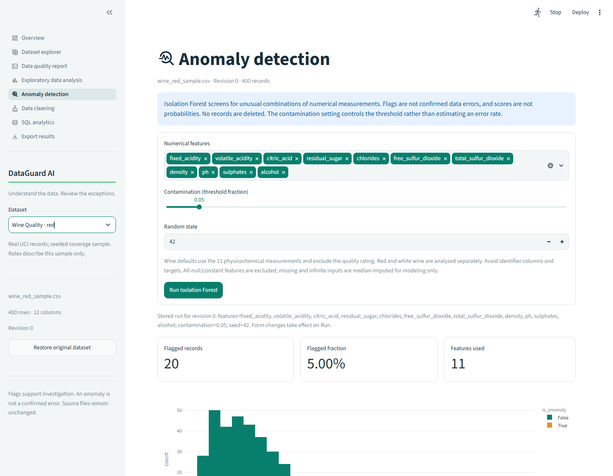

# DataGuard AI

**Automated data quality assessment and anomaly review, with explicit rules and traceable cleaning.**

DataGuard AI helps an analyst inspect a CSV before relying on it: identify missingness and repeats, configure validity rules, explore distributions, screen numerical observations, preview cleaning, and export a documented result. It is an independent Python portfolio project built for review, not a production data governance service.

## What works

- Eight Streamlit pages: Overview, Dataset explorer, Data quality report, Exploratory data analysis, Anomaly detection, Data cleaning, SQL analytics, and Export results.
- Bounded CSV upload with explicit encodings/separators, malformed-record detection, identifier preservation, and descriptive profiling.
- Configurable types, numeric ranges, dates, allowed categories, and required columns; transparent score, severity, positional examples, and remediation suggestions.
- Plotly distributions, boxplots, missingness, correlations, frequencies, and outlier summaries.
- Reproducible median-imputation + Isolation Forest pipeline, feature exclusions, scores, labels, and configurable contamination/seed.
- Cleaning previews and explicit adoption, revision-aware transformation history, immutable source copy, and original-data restore.
- Isolated SQLite analytics with SELECT, WHERE, GROUP BY, LEFT JOIN, CTE, window functions, and quality summaries.
- Current dataset, quality CSV/JSON, anomaly CSV/settings, and transformation-log exports.
- Official UCI downloads with pinned checksums, Excel-to-CSV conversion, real coverage samples, and offline tests.

**Anomaly flags are observations for investigation, not confirmed errors. No anomalies are automatically deleted.**

## See the application

These images are captured from the actual local application; no deployment is claimed.







## Setup on Windows

Use Python **3.12** and run all commands from the repository root. The project was verified on Windows with Python 3.12.0; `requirements.txt` pins direct and transitive versions, including Streamlit 1.66.0, Pandas 2.3.3, NumPy 2.5.4, scikit-learn 1.9.1, and Plotly 6.9.0.

```powershell
python -m venv .venv
.\.venv\Scripts\python.exe -m pip install -r requirements.txt
.\.venv\Scripts\python.exe -m streamlit run app/main.py
```

The demo works immediately using the committed samples, without downloading full datasets or requiring credentials. Direct virtual-environment commands avoid PowerShell activation-policy changes. On macOS/Linux use `.venv/bin/python` instead of `.\.venv\Scripts\python.exe`.

`requirements.in` lists direct dependency constraints for deliberate upgrades; ordinary setup uses the exact `requirements.txt`. The app resolves project paths relative to its files and has no machine-specific runtime path dependency.

Clean setup was independently verified in a copied source tree with a fresh Python 3.12 virtual environment, user site packages disabled, and no raw datasets or existing caches. All 50 locked packages installed, all 88 tests passed, and the real Streamlit browser workflow ran successfully. `.gitattributes` preserves LF text endings so dataset checksums remain valid after Windows Git checkouts.

## Suggested demo workflow

1. Start with **Online Retail · primary**. Inspect missing customer IDs, missing descriptions, repeated records, return/cancellation context, and negative-price rule findings.
2. Open Data quality report to inspect the scoring formula and JSON rule configuration. Negative quantities are permitted; cancellations and zero prices are context flags.
3. Use EDA to inspect distributions and category frequencies. Preview removing the one repeated sample row, then explicitly apply it. Restore the original when finished.
4. Open SQL analytics and compare the group, join, CTE, and window examples. Sample net line values describe the sample only.
5. Switch to **Wine Quality · red** or **Wine Quality · white**, open Anomaly detection, and run the default model. It uses 11 measurements, excludes the quality rating, and reports scores for every observation.
6. Export the accepted current revision, findings, model results, and transformation history. Pending cleaning previews are excluded. Applying cleaning or switching datasets clears stale model results.

## Dataset reproduction

| Dataset | Full rows × columns | Bundled rows | Source and license |
|---|---:|---:|---|
| Online Retail | 541,909 × 8 | 1,200 | [UCI 352](https://archive.ics.uci.edu/dataset/352/online+retail), [CC BY 4.0](https://creativecommons.org/licenses/by/4.0/) |
| Wine Quality, red | 1,599 × 12 | 400 | [UCI 186](https://archive.ics.uci.edu/dataset/186/wine+quality), [CC BY 4.0](https://creativecommons.org/licenses/by/4.0/) |
| Wine Quality, white | 4,898 × 12 | 400 | Same source and license |

Credit: Chen, D. (2015), Online Retail, DOI [10.24432/C5BW33](https://doi.org/10.24432/C5BW33); Cortez, P., Cerdeira, A., Almeida, F., Matos, T., & Reis, J. (2009), Wine Quality, DOI [10.24432/C56S3T](https://doi.org/10.24432/C56S3T).

```powershell
.\.venv\Scripts\python.exe -m scripts.download_data
.\.venv\Scripts\python.exe -m scripts.preprocess_data
.\.venv\Scripts\python.exe -m scripts.validate_demos --output-dir reports/local
.\.venv\Scripts\python.exe -m scripts.validate_demos --full --output-dir reports/local
```

Retail is converted from Excel with all rows retained; wine's semicolon CSVs become separate comma CSVs with normalized headers. No imputation, filtering, or correction occurs in this conversion. Samples are real source-row subsets, generated with seed 42 and enriched for varied cases. They are not unbiased population samples. Exact source positions, transformations, and file hashes are recorded in `data/sample/provenance.json`.

Raw archives and complete converted data remain local and are Git-ignored. The full retail CSV exceeds the interactive upload row limit, so full-data evaluation uses the CLI. See [dataset methodology and recovery instructions](docs/DATASETS.md) and [data attribution](data/LICENSE_DATA.md).

## Verified results

Measured from the downloaded sources using the committed scripts and dependency lock:

| Check | Full source-derived data | Bundled sample |
|---|---:|---:|
| Retail records | 541,909 | 1,200 |
| Missing retail CustomerID | 135,080 | 314 |
| Missing retail Description | 1,454 | 22 |
| Repeated retail rows after first occurrence | 5,268 | 1 |
| Retail negative-price rule findings | 2 | 2 |
| Wine red flagged observations | 80 / 1,599 | 20 / 400 |
| Wine white flagged observations | 245 / 4,898 | 20 / 400 |

Wine counts use 200 trees, contamination 0.05, seed 42, separate cohorts, and the 11 measurements. Repeated fits produced identical scores/labels in the tested environment. These counts do not measure detection accuracy or confirmed data errors. Imbalanced ratings are retained as metadata and excluded from model features.

Full retail has 10,624 negative-quantity rows and 9,288 cancellation-marked rows. These context categories can overlap and are retained. The project score is 98.55 despite substantial CustomerID missingness; aggregate satisfaction can dilute important field-level issues. Always inspect findings, not just the score.

Machine-readable evidence: [full results](reports/reference/full_results.json) and [sample results](reports/reference/sample_results.json). [Methodology](docs/METHODOLOGY.md) defines score denominators, model preprocessing, SQL eligibility, cleaning order, and export behavior.

## Architecture

```text
app/main.py                 Streamlit entry point, shared dataset selector and routing
app/app_pages/              Eight page scripts
app/state.py                Per-session source/current copies and revision lifecycle
src/dataguard/
  ingestion.py              Strict, bounded CSV parsing
  profiling.py              Missingness, dtypes, cardinality, descriptive helpers
  validation.py             Rules, findings, and explicit score
  cleaning.py               Copy-based transformations and operation log
  anomaly_detection.py      Median imputation + Isolation Forest
  sql_analytics.py          Temporary relational view and curated queries
  reporting.py              Strict JSON and CSV exports
scripts/                    Download, preprocessing, dataset evaluation, browser smoke
sql/                        Seven reviewed example queries
tests/                      Synthetic edge cases, real UCI samples, Streamlit workflows
data/sample/                Attributed real subsets and deterministic provenance
data/sources.json           Official URLs, citations, licenses, archive hashes
reports/reference/          Actual measured sample/full results, no full raw records
docs/                       Dataset, methodology, deployment, Git, and career notes
```

Pandas/NumPy implement data processing, scikit-learn provides statistical screening, SQLite demonstrates relational analytics, Plotly renders interactive charts, and pytest/Ruff verify behavior and code quality. Business logic is independent of Streamlit. Public sample bytes alone use a shared bounded cache; uploaded datasets and analysis results remain in per-session memory. SQL uses a fresh private database for each run.

## Verification

```powershell
.\.venv\Scripts\python.exe -m pytest -q
.\.venv\Scripts\python.exe -m ruff check src app scripts tests
.\.venv\Scripts\python.exe -m ruff format --check src app scripts tests
.\.venv\Scripts\python.exe -m pip check
```

The final local run passed **88 tests**. Tests cover ingestion/encoding/limits, missingness/repeats, types/dates/ranges/categories, empty/all-null/constant data, cleaning logs and immutability, reproducible anomaly screening, SQL safety/joins/aggregations, exports, dataset hashes, all EDA variants, and UI navigation/revision workflows. Fixtures labeled synthetic are used for controlled errors; real-sample tests use only attributed UCI records. GitHub Actions is configured; a remote CI run is not claimed before publication.

For the optional real-browser check and screenshot regeneration, with Chrome/Chromium/Edge installed:

```powershell
.\.venv\Scripts\python.exe -m scripts.browser_smoke
```

This starts a temporary localhost server and headless browser with a fresh profile, verifies the running app, and writes actual screenshots to `assets/screenshots/` and a local report under `reports/local/`. It closes its own processes. The completed local run verified rendered charts, model execution, fresh dataset/anomaly CSV downloads, real-sample upload, malformed-upload rejection, and a mobile export viewport; [browser evidence](reports/reference/browser_smoke.json) is included. See [FINAL_AUDIT.md](FINAL_AUDIT.md) for the exact completed checks and remaining verification limits.

## Limits and deployment

- Statistical flags are exploratory, with no verified error labels or held-out predictive evaluation. Different features, seeds, imputation, cohorts, or thresholds can change results.
- A project-defined quality score is not a guarantee. Missing identifiers cannot be safely invented; repeated transactions and returns require domain review.
- Interactive CSVs are limited to 25 MiB / 200,000 rows / 250 columns; model fitting is limited to 10–50,000 rows and charts use bounded samples.
- Per-tab session state is temporary. Refreshes/reconnects/server restarts can lose work. Download accepted results before leaving.
- This app sends uploaded data to its hosting server for processing. It has no authentication, tenant isolation guarantee, or persistent audit store. Use public/non-sensitive demo data for a public deployment.
- Generic feature suitability and validity rules require analyst judgment. No automatic customer identity inference, anomaly deletion, or source-file writeback is provided.

The repository is prepared for Streamlit Community Cloud with entry point `app/main.py`, Python 3.12, root `requirements.txt`, and committed samples. See [deployment steps](docs/DEPLOYMENT.md). No app has been published and no public URL exists.

Future improvements include versioned rule configuration, richer per-field weighting, saved reviewed decisions, batch ingestion, held-out monitoring when appropriate labels exist, and authenticated storage for a separately designed production service.

## GitHub and portfolio

[Git review and publication commands](docs/GITHUB.md) are provided for manual execution after approval. A clean local initial commit is prepared on `main`; no remote, push, or public deployment has been created. [Publication audit evidence](reports/reference/publication_audit.json) records the clean-environment checks, screenshot hashes, ignore checks, and credential-pattern scan. [Career notes](docs/CAREER_NOTES.md) contain three implementation-based CV bullets and five technical interview answers. This project does not claim commercial employment, customers, revenue gains, or production adoption.

Code: [MIT](LICENSE). Bundled UCI samples: [CC BY 4.0 with attribution](data/LICENSE_DATA.md). Third-party dependencies retain their own licenses.
